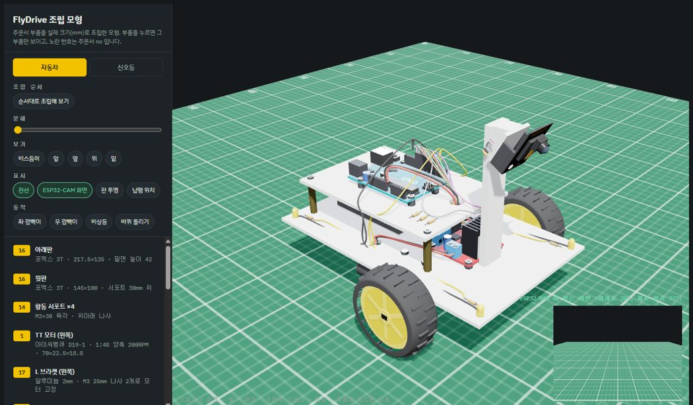
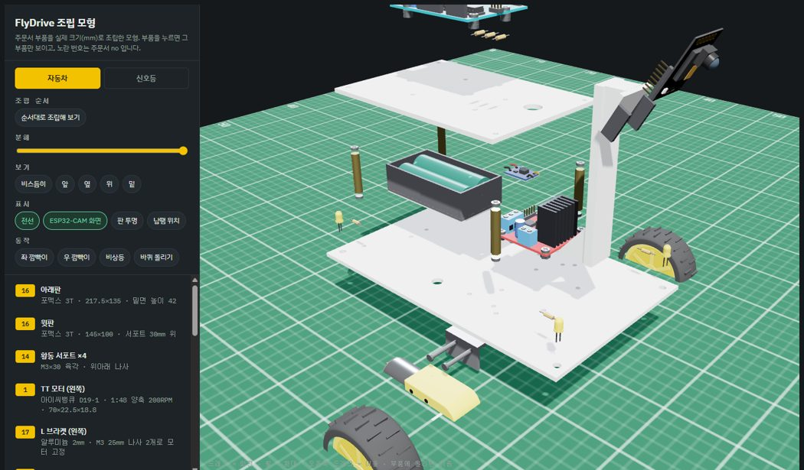
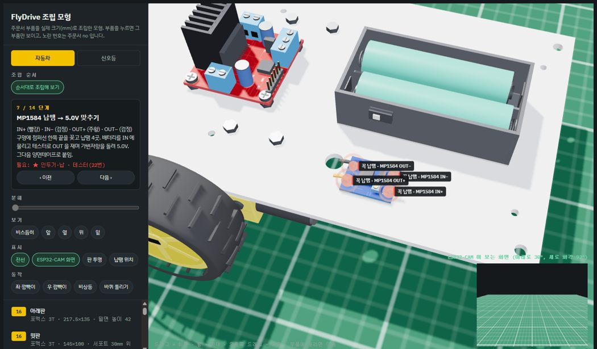

# FlyDrive

**FlyDrive**는 성체 초파리의 실제 뇌 커넥톰인 **FlyWire**를 활용해 미니어처 운전면허 기능시험 코스를 주행하는 자율주행 로봇 프로젝트이다.

카메라로 주행 환경을 인식하고, 커넥톰 기반 신경망을 통해 주행 행동을 결정한다. 시험 규칙에 따른 점수와 보상 신호를 제공해 로봇이 반복적인 학습을 통해 주행 능력을 개선하도록 설계한다.

Arduino 기반 로봇과 직접 제작한 시험 코스를 통해 차선 유지, 신호 준수, 정지, 회전 및 주차 등의 과제를 구현하고, 커넥톰 기반 제어가 자율주행과 학습에 어떻게 활용될 수 있는지 탐구한다.

## 제작용 3D 조립 모형

### ▶ [3D 모형 열기](https://kth-0121.github.io/FlyWire-Driver/)

브라우저에서 바로 돌려 보는 조립 모형이다. 주문서 부품을 실제 치수(mm)로 조립했다. 설치는 필요 없다.

| 분해 | 7단계: MP1584 납땜 |
|---|---|
|  |  |

**쓰는 법**
- 마우스: 드래그로 회전, 휠로 확대, 오른쪽 드래그로 이동한다. 부품에 마우스를 올리면 이름·주문 번호·규격이 나오고, 누르면 그 부품만 남는다.
- **순서대로 조립해 보기**: 14단계 조립 순서. ‹ › 버튼이나 키보드 ← → 로 넘긴다. 단계마다 부품이 제자리에 끼워지고 할 일과 필요한 공구가 나온다.
- **납땜 위치**: 빨강은 꼭 납땜할 곳(MP1584 4곳), 주황은 납땜하면 좋은 곳(7곳, 꼬아서 테이프로 감아도 된다).
- **분해**, **전선**, **ESP32-CAM 화면**(차 카메라가 보는 장면), **깜빡이·바퀴 동작**을 켜고 끌 수 있다.
- **신호등** 탭: 기둥, 등 머리, LED, Uno 배선. `road_signal.ino` 순서대로 불이 바뀐다.

오프라인에서 볼 때는 [`docs/index.html`](docs/index.html)을 내려받아 브라우저로 연다. 인터넷 연결은 필요하다(3D 라이브러리를 불러온다).

## 제작 도안

| 파일 | 내용 |
|---|---|
| `blueprint/조립설계도.pdf` | 배선도, 배선표, **차체판 1:1 구멍 도안**(3·4쪽, 실제 크기 100%로 출력), 신호등, 조립 순서 |
| `blueprint/도안.pdf` | 코스 도안 (조각 9개, cm 치수도·상세도·좌표표) |
| `blueprint/자동차.pdf`, `blueprint/자동차_3D.pdf` | 차량 배치도 |
| `arduino/road_signal/road_signal.ino` | 도로 신호등 (남는 Uno, D2~D9) |

도안은 `python assembly.py`, `python blueprint.py`, `python car3d.py`, `python car_blueprint.py` 로 다시 만든다.
